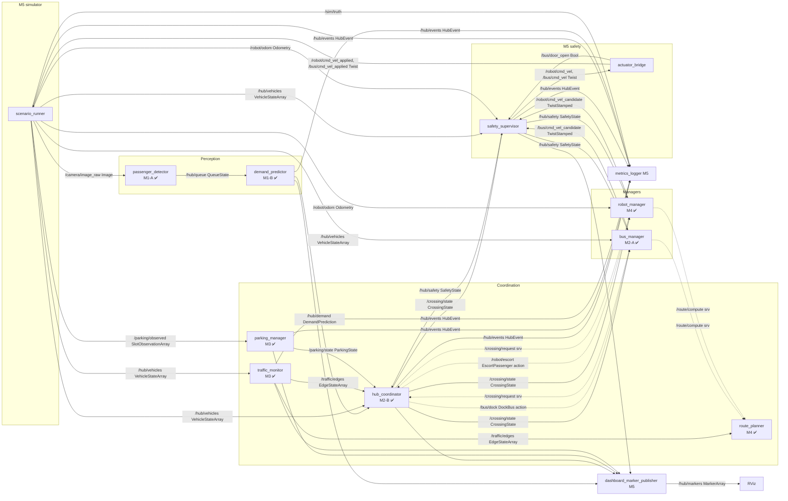

# Smart Mobility Hub — ROS 2 Simulation & System Architecture

Smart Mobility Engineering Lab (Prof. Mehdi Pirahandeh), Inha University.
A miniature Songdo transport station in ROS 2: detect passengers, predict
demand, dock a bus, manage parking, route traffic, escort a passenger with a
robot — and stop safely when anything goes wrong. Every decision must leave
observable, reproducible evidence (assignment §1).

> **Status (branch `integration/current-team-work`).** M5 (simulator,
> safety, infrastructure), M1-A (passenger counting) and M1-B (demand
> prediction), M2-B (coordinator) and M3 (parking, traffic) are in the ROS
> package, built, tested and started together by `hub.launch.py`. M3's S4
> and S5 pass live (checkers written by M5); M2-A's bus (S3) passes 12/12
> live; M2-B's T04 dispatch passes 6/6 live; M4's routing (S6 8/8), escort
> (S7 9/9) and T18 (5/5) pass live; the integrated rush hour **S8/T15 passes
> 20/20** episodes with zero safety violations. **Left: Husan's real video.** See
> [§10 Status](#10-current-status-and-next-steps).

Platform: **ROS 2 Jazzy, Ubuntu 24.04, Python `rclpy`**, run in Docker
(verified on Apple Silicon `aarch64`). Requirements and section numbers (§)
refer to `Smart_Mobility_Hub_Assignment.pdf`; roles come from the
7-person role document. Both PDFs are kept out of git.

**Contents:** [0 Like you are 5](#0-explained-like-you-are-5) ·
[11 Finish line](#11-the-finish-line--whats-left-ez-mode-) ·
[1 Overview](#1-project-overview) ·
[2 Repository map](#2-repository-map) ·
[3 Architecture](#3-architecture-and-data-flow) ·
[4 Setup](#4-environment-setup) ·
[5 Running](#5-how-to-run-the-project) ·
[6 Developing](#6-how-to-develop-a-new-component) ·
[7 Standards](#7-team-integration-standards) ·
[8 Tests](#8-tests-and-acceptance-criteria) ·
[9 Git workflow](#9-git-workflow-for-teammates) ·
[10 Status](#10-current-status-and-next-steps)

---

## 0. Explained like you are 5

**What are we building?** A tiny pretend bus station inside the computer.
People wait in a line, a bus comes to pick them up, cars look for parking,
and a little robot walks people across the road. Nothing is real: a
computer program pretends to be the whole world, like a video game.

**Who does what?** Think of the computer programs as helpers. Each helper
has one job, and they talk by sending little notes (ROS *messages*) to each
other.

| Helper (program) | Its one job | Like a… | Who made it |
|---|---|---|---|
| `scenario_runner` | pretends to be the whole world and moves everything 20 times a second | the game world | M5 |
| camera (inside `scenario_runner`) | takes 10 pictures a second of the waiting line | eyes | M5 |
| `passenger_detector` | looks at the pictures and counts the people in the line | someone counting | M1-A |
| `demand_predictor` | guesses how many people will be waiting in 30 seconds | a weather forecaster | M1-B |
| `hub_coordinator` | decides when to send the bus and who may cross the road | a traffic police officer | M2-B |
| `bus_manager` | drives the bus to the stop and opens its door | a bus driver | M2-A |
| `parking_manager`, `traffic_monitor` | keeps track of free parking spaces and traffic jams | parking attendant, traffic reporter | M3 |
| `route_planner`, `robot_manager` | finds the best path and walks the robot | a map app, a guide | M4 |
| `safety_supervisor` | checks every move before it happens; says STOP if anything is wrong | a lifeguard | M5 |
| `actuator_bridge` | turns the wheels, but stops by itself if the lifeguard goes quiet | the brakes | M5 |
| `metrics_logger` | writes down everything that happened | a diary | M5 |
| `dashboard_marker_publisher` | draws the picture of the station for people to watch | a TV screen | M5 |

**The most important rule:** the drivers (bus and robot) may only *ask* to
move. The lifeguard (`safety_supervisor`) decides. If someone presses the
big red STOP button, everything stops, and it stays stopped until a grown-up
checks that everything is safe and presses "reset".

### How do we make the simulation?

1. **Get the toy box ready once:** install Docker Desktop, open it, then
   run `docker/hub.sh image`. This builds a little Linux computer with
   ROS 2 inside your computer.
2. **Build the helpers:** `docker/hub.sh build`.
3. **Check that nothing is broken:** `docker/hub.sh test`. Every test must
   pass before you share your work.
4. **Play a story (a *scenario*):**
   - `docker/hub.sh s1` — people walk into the line; the counter must say
     0, 3, 5, 4. (M1-A's story)
   - `docker/hub.sh s9` — the robot drives, someone presses STOP, and we
     check it stops in time and only restarts safely. (M5's story)
5. **Watch the whole chain:** `docker/hub.sh shell`, then
   `ros2 launch smart_hub hub.launch.py scenario:=S1 perception:=true`
   (camera → counter → forecaster → screen).
6. **Look at the proof:** everything that happened is written in `output/`
   (pass/fail files, diaries, recordings called *bags*).

A story is a small file in `src/smart_hub/scenarios/` that says *what
happens when* (for example "at 5 seconds, three people arrive"). The same
story with the same *seed* always plays out exactly the same way, so we can
repeat any test.

### How do we hand in the assignment? (§24)

Think of it as packing five boxes for the teacher:

1. **The code box.** The whole repository at one commit: all packages, the
   message files, launch files, settings, scenario stories and tests. Write
   the commit hash in the report. (`git log -1`)
2. **The report box** (12–18 pages): what we had to build, the map, the
   ROS graph, why each message/service/action was chosen, the state
   machines, how the AI model was trained and tested, the safety rules,
   **every test T01–T18 with its result** (including the ones that failed
   or are blocked, with the reason), what does not work yet, and a table of
   who did what. Draft: [`docs/report/REPORT.md`](docs/report/REPORT.md) →
   PDF with `docker/hub.sh report`.
3. **The proof box** (evidence): videos, rosbag recordings, the CSV/JSON
   files from `output/`, the training scripts and the model file. Ours
   starts in [`evidence/`](evidence/README.md) (M5 and M1-A so far).
4. **The 8-minute show:** 1 min map and design → 2 min detection, dispatch,
   docking, parking → 2 min robot and rerouting → 2 min faults, cancel and
   reset → 1 min numbers and limitations.
5. **The individual talk:** each person explains one message path they
   built, one service or action from start to end, and one test that failed
   and how they fixed it. You must understand your own code line by line.

Rules from the teacher: never delete a failed test from the report (explain
it instead), say clearly what is only proven in simulation, and grading is
80 points team + 20 points individual.

## 1. Project overview

Nine scenarios on one 12 m × 8 m map (§2): S1 passenger counting, S2 AI
demand prediction, S3 bus docking, S4 parking, S5 congestion, S6 route
replanning, S7 robot escort, S8 integrated rush hour, S9 faults and
emergency stop. Managers never drive motors: they publish *candidate*
velocities, and only `safety_supervisor` publishes final commands (§4.2).

| Member | Role | Nodes (§4, role doc) | Scenario | Code in this branch |
|---|---|---|---|---|
| M1-A Husan | Perception | `passenger_detector` | S1 | ✅ merged (branch `feature/m1a-passenger-detector`) |
| M1-B Tuymurod | Demand prediction | `demand_predictor` | S2 | ✅ merged |
| M2-A Fazliddin | Bus & docking | `bus_manager` | S3 | ✅ S3 12/12 live, T05 10/10, T06 ([README_M2A](README_M2A.md), [evidence/m2a](evidence/m2a)) |
| M2-B Arkar | Hub coordinator | `hub_coordinator` | S8 | ✅ 28 tests + T04 6/6 live ([evidence/m2b](evidence/m2b)); ✅ S8/T15 20/20 ([evidence/s8](evidence/s8)) |
| M3 Carla | Parking & traffic | `parking_manager`, `traffic_monitor` | S4, S5 | ✅ code in the package + 59 tests; ✅ S4 11/11 and S5 9/9 live ([evidence/m3](evidence/m3)) |
| M4 Aidil | Routing & robot | `route_planner`, `robot_manager` | S6, S7 | ✅ S6 8/8, S7 9/9, T18 5/5 live ([README_M4](README_M4.md), [evidence/m4](evidence/m4)) |
| M5 Saidumar | Simulator, safety, infra | `scenario_runner`, `safety_supervisor`, `actuator_bridge`, `metrics_logger`, `dashboard_marker_publisher` | S9 | ✅ complete for simulation |

## 2. Repository map

```
.
├── README.md                    ← this file (team entry point)
├── README_M5.md                 M5 design notes and evidence
├── README_M2B.md                M2-B coordinator notes (from main)
├── RUN_ON_MAC.md, Dockerfile, s2.sh, .dockerignore   M1-B's S2 Docker workflow
├── docker/
│   ├── Dockerfile               team dev image (ROS 2 Jazzy, pinned digest)
│   └── hub.sh                   build / test / run helper (repo mounted at /ws)
├── docs/
│   ├── INTEGRATION_CONTRACT.md  topics, services, IDs, safety and reset rules
│   └── TEAM_STANDARDS.md        short copyable conventions
└── src/
    ├── smart_hub_interfaces/    SHARED: 14 msg, 6 srv, 3 action (§6–7)
    └── smart_hub/               SHARED ament_python package (all nodes)
        ├── smart_hub/
        │   ├── demand/                  M1-B pure logic (features, models, policy, simulation)
        │   ├── passenger_detector.py    M1-A node: /camera/image_raw -> /hub/queue
        │   ├── perception/              M1-A pure logic (detectors, homography, tracker, zones)
        │   ├── s1_check.py, video_publisher.py  M1-A S1 check, recorded-video camera
        │   ├── demand_predictor.py      M1-B node: /hub/queue -> /hub/demand
        │   ├── fake_queue_publisher.py  M1-B test tool: synthetic /hub/queue
        │   ├── scenario_runner.py       M5 node   + sim_core.py (20 Hz simulator)
        │   ├── camera_model.py          M5 synthetic camera (draws pedestrians)
        │   ├── safety_supervisor.py     M5 node   + safety_core.py
        │   ├── actuator_bridge.py       M5 node   + bridge_core.py
        │   ├── metrics_logger.py        M5 node   + metrics_core.py
        │   ├── dashboard_marker_publisher.py  M5 node + marker_core.py
        │   ├── geometry.py, ros_common.py      M5 shared helpers (map, QoS)
        │   ├── s9_fault_check.py        M5 test tool: S9 sequence, T16/T17
        │   └── mock_candidate_publisher.py     M5 test tool: stand-in for M2-A/M4
        ├── launch/  hub.launch.py, s9.launch.py (M5) · s1.launch.py (M1-A) · demand_demo.launch.py (M1-B)
        ├── config/  m5_safety.yaml (M5) · passenger_detector.yaml (M1-A) · demand_predictor.yaml (M1-B)
        ├── scenarios/S1.yaml, S9.yaml (M5)   models/demand_ridge_h30.json (M1-B)
        ├── scripts/train_demand_model.py · results/ (M1-B T03 evidence)
        ├── test/    test_m1a_*, test_passenger_detector_node, test_s1_launch (M1-A) · test_demand_*.py (M1-B) · the rest (M5)
        ├── setup.py, package.xml        SHARED (every member adds entries)
        └── README.md                    M1-B S2 notes
```

**Shared files** (change only with the affected owners' agreement):
`src/smart_hub_interfaces/**`, `src/smart_hub/setup.py`,
`src/smart_hub/package.xml`, `docker/`, `docs/`, this README.
Everything else belongs to the member named above.

## 3. Architecture and data flow



Solid arrows are topics; dotted arrows are services/actions. The full
inventory with rates, QoS and owners is in
[docs/INTEGRATION_CONTRACT.md §3–4](docs/INTEGRATION_CONTRACT.md#3-topics).

**How the M5 stack works.** `scenario_runner` steps a deterministic 2D world
at a fixed 0.05 s and publishes odometry, observed vehicles, parking sensors
and the e-stop heartbeat. `safety_supervisor` checks every 50 ms (monotonic
clock) that the e-stop is released, inputs are fresh, there is clearance,
the bus door is shut and crossing C is granted, then clamps and forwards the
candidates. `actuator_bridge` independently zeroes any final command older
than 0.5 s, and the simulator stops any body without a fresh applied
command — three layers that each stop the robot alone (T17).
`metrics_logger` writes per-run evidence; `dashboard_marker_publisher`
draws the state for RViz and has no control authority.

## 4. Environment setup

Supported: **Docker** with the ROS 2 Jazzy image (`docker/`). Do not install
a native ROS on macOS; Jazzy does not support it.

Prerequisites: Docker Desktop running (Apple Silicon or x86 both work — the
base image is multi-arch), git, about 4 GB free for the image.

```bash
docker/hub.sh image
```
```bash
docker/hub.sh build
```

- The repository is **mounted** at `/ws`, not copied: edit on your machine,
  then `docker/hub.sh build` (needed after adding files or editing
  `setup.py`; `--symlink-install` picks up Python edits automatically).
- `build/ install/ log/ output/` appear in the repo root; all are git-ignored.
- Builds use one package at a time and `-j2` because Docker Desktop on an
  8 GB Mac gives Linux about 4 GB.
- The base image is pinned by digest so everyone builds on the same ROS.
- M1-B's older workflow (`./s2.sh build`, `./s2.sh test`, root `Dockerfile`)
  still works on this branch — it copies `src/` into its own image, so code
  changes need `./s2.sh build` again. Verified: 134 tests, 0 failures.

## 5. How to run the project

| Goal | Command | Result |
|---|---|---|
| Run all tests | `docker/hub.sh test` | colcon test + summary |
| S9 acceptance demo (~20 s) | `docker/hub.sh s9` | `S9 verdict: PASSED`, exit 0 only if every check passed; evidence in `output/` (check JSON, metrics, rosbag, parameter dumps) |
| S1 passenger counting (~45 s) | `docker/hub.sh s1` (or `s1 hog`) | `S1 verdict: PASSED`; `output/s1_check.json`, `s1_count_vs_truth.png`, dashboard pictures |
| S3 bus docking (~12 min, M2-A) | `docker/hub.sh s3` (or `s3 1`: 1 nominal trial, ~5 min) | `S3 verdict: PASSED`; `output/s3_check.json`, `s3_trials.csv`, `s3_trace.csv`, `s3_events.csv`, `s3_paths.png` |
| T04 bus dispatch (~4 min, M2-B) | `docker/hub.sh t04` | `t04 verdict: PASSED`; `output/t04_check.json`, `t04_timeline.csv` |
| S4 parking (~45 s, M3's node) | `docker/hub.sh s4` | `s4 verdict: PASSED`; `output/s4_check.json` |
| S5 congestion (~90 s, M3's node) | `docker/hub.sh s5` | `s5 verdict: PASSED`; `output/s5_check.json`, `s5_labels.png`, `s5_timeseries.csv` |
| S6 routing (~1.5 min, M4) | `docker/hub.sh s6` | `s6 verdict: PASSED`; `output/s6_check.json`, `s6_routes.csv`, `s6_maps.png` |
| S7 robot escort (~15 min, M4) | `docker/hub.sh s7` (or `s7 1`) | `S7 verdict: PASSED`; `output/s7_check.json`, `s7_trials.csv`, `s7_trace.csv`, `s7_events.csv`, `s7_paths.png` |
| T18 planner loss (~1 min, M4 + M5) | `docker/hub.sh t18` | `t18 verdict: PASSED`; `output/t18_check.json` |
| S8 rush hour + T15 (~90 min, everyone) | `docker/hub.sh s8` (or `s8 2` for 2 seeds) | `T15 PASSED`; `output/s8/s8_summary.json`, `s8_runs.csv`, `s8_compare.png`, one folder per episode, rosbag + dashboard video of seed 1 |
| S9 faults × 5 mission phases (~4 min) | `docker/hub.sh s9x` | `S9 repeat verdict: PASSED`; `output/repeat/s9_repeat.{json,csv}` |
| Live dashboard (Foxglove) | `docker/hub.sh view` | connect Foxglove to `ws://localhost:8765` |
| Team report PDF | `docker/hub.sh report` | `docs/report/Smart_Mobility_Hub_Report.pdf` |
| Shell with workspace sourced | `docker/hub.sh shell` | interactive bash in `/ws` |
| One command | `docker/hub.sh run 'ros2 node list'` | |

Inside `docker/hub.sh shell`:

```bash
ros2 launch smart_hub hub.launch.py scenario:=S9 seed:=9 mode:=sim
```
Starts `scenario_runner`, `safety_supervisor`, `actuator_bridge`,
`metrics_logger`, `dashboard_marker_publisher`. Arguments: `scenario`
(file in `scenarios/`), `seed`, `mode` (only `sim`; `hardware` is refused),
`output_dir` (default `output`), `publish_estop` (`true`: the runner sends
the 10 Hz e-stop heartbeat).

```bash
ros2 launch smart_hub demand_demo.launch.py seed:=1025 run_id:=demo
```
M1-B's S2 demo (fake queue → predictor; forecast valid after ~60 s warm-up).

```bash
ros2 launch smart_hub hub.launch.py scenario:=S1 perception:=true
```
Full perception chain on the simulator camera: `passenger_detector` (M1-A)
→ `/hub/queue` → `demand_predictor` (M1-B) → dashboard text. S1 lasts 40 s,
shorter than the predictor's 60 s warm-up, so the forecast stays
`prediction unavailable` there; use a longer scenario to see a forecast.

Useful inspections (all verified):
```bash
ros2 topic echo /hub/safety
```
```bash
ros2 topic pub --times 3 -r 10 -w 1 --qos-durability transient_local /hub/estop std_msgs/msg/Bool "{data: true}"
```
```bash
ros2 service call /safety/clear_stop smart_hub_interfaces/srv/ClearSafetyStop "{operator_id: me, acknowledgement: ok}"
```
```bash
ros2 service call /scenario/reset smart_hub_interfaces/srv/ResetScenario "{scenario_id: S9, seed: 42, preserve_logs: true}"
```
```bash
ros2 topic hz /hub/markers
```

**Outputs.** `output/s9_check.json` (S9 checks, T16 latencies),
`output/<run_id>/events.csv` and `summary.json` (stop latencies, physical
stop times, `motion_while_latched`, interventions; the commit is recorded,
with `-dirty` when `src/` or `docker/` has uncommitted changes).

**Dashboard / RViz.** `/hub/markers` (5 Hz, frame `map`) draws: site,
queue Q with forecast text (`demand +30s: …` or `prediction unavailable`),
graph edges plus red **blocked** / dark-grey **unknown** / orange
**density ≥ 0.70** overlays from `/traffic/edges`, crossing C coloured by
`/crossing/state`, parking slots by `/parking/state`, vehicles and obstacle
O as footprint cylinders, planned routes from `/robot/route` and
`/bus/route` (`nav_msgs/Path`) as coloured lines with a goal label, and
safety/last-event text. Anything older than 1 s is drawn grey/UNKNOWN
(routes are plans and stay until replaced or cleared). **Not drawn:**
speed-based congestion (`EdgeState` has no label).
**Seeing it** (the container has no screen, so two ways that work on a Mac):
- **Pictures + video, no setup:** `docker/hub.sh s9` and `docker/hub.sh s1`
  save `output/dashboard/frame_*.png`, `latest.png` and `dashboard.mp4`
  (`dashboard_snapshot` draws `/hub/markers` top-down; `record_dashboard:=true`
  in `hub.launch.py`).
- **Live:** `docker/hub.sh view` (S1 with the perception chain and a
  circling robot), then open the free **Foxglove** app (foxglove.dev, needs a
  free account) → *Open connection* → *Foxglove WebSocket* →
  `ws://localhost:8765` → add a **3D** panel (display frame `map`, enable
  `/hub/markers`, `/robot/route`) and an **Image** panel on
  `/camera/image_raw`. Verified: the bridge (foxglove_bridge 3.6.0, arm64)
  accepts the connection and offers 30 topics. Ctrl+C stops.
- On a Linux desktop with ROS 2 Jazzy: RViz, Fixed Frame `map`,
  *MarkerArray* on `/hub/markers`.

**Troubleshooting (all seen during development)**

| Symptom | Cause / fix |
|---|---|
| `Cannot connect to the Docker daemon` | start Docker Desktop |
| `Unknown package 'smart_hub_interfaces'` from the CLI | workspace not sourced: use `docker/hub.sh shell`/`run`, or `source install/setup.bash` |
| `ros2 topic pub --once` e-stop has no effect | it can exit before discovery; use `--times 3 -r 10 -w 1` as above |
| `ros2 node list` empty right after launch | CLI discovery delay; nodes still run — use `ros2 topic hz` |
| New node "executable not found" | add it to `setup.py` `console_scripts`, then `docker/hub.sh build` |
| Everything held, reason `ESTOP_SIGNAL_STALE` | nothing publishes `/hub/estop`; launch with `publish_estop:=true` (default) |

## 6. How to develop a new component

Conventions used by every node in this package:

1. **Pure logic module** (no ROS imports) — e.g. `smart_hub/my_core.py`,
   time passed in as an argument so tests need no sleeps.
2. **Thin ROS node** `smart_hub/my_node.py` with `main()`; import QoS
   profiles from `smart_hub.ros_common` (`R1, R10, R100, R1T`) and message
   types **only** from `smart_hub_interfaces` — never copy a `.msg`.
3. **Register** in `src/smart_hub/setup.py`:
   `'my_node = smart_hub.my_node:main',` (under your member comment), and
   add new ROS dependencies to `src/smart_hub/package.xml`.
4. **Launch**: own `launch/my_demo.launch.py`; add your node to
   `hub.launch.py` once it is ready for the integrated run.
5. **Tests** in `src/smart_hub/test/test_my_*.py` (pytest); ROS node tests
   skip cleanly when ROS is missing (see `test_scenario_runner_node.py`).
6. **Verify**: `docker/hub.sh build && docker/hub.sh test` — 0 failures,
   flake8 + pep257 clean (single quotes, imports sorted alphabetically,
   lines ≤ 99).

Need a new message or field? Do **not** add it alone: follow
[INTEGRATION_CONTRACT.md §10](docs/INTEGRATION_CONTRACT.md#10-changing-this-contract).

## 6.1 Plugging your node into the hub (for the next members)

Every mobile-agent manager and every stateful node follows the same five
rules. Copy the snippets; all helpers are in `smart_hub.ros_common`.

**1. Ask to move — never drive.** Publish a *stamped* candidate at 20 Hz;
`safety_supervisor` decides and publishes `/robot/cmd_vel`, `/bus/cmd_vel`.
```python
from geometry_msgs.msg import TwistStamped
from smart_hub.ros_common import R1
self.cmd_pub = self.create_publisher(TwistStamped, '/robot/cmd_vel_candidate', R1)
msg = TwistStamped()
msg.header.stamp = self.get_clock().now().to_msg()   # stamp NOW, or it is rejected
msg.header.frame_id = 'robot/base_link'
msg.twist.linear.x, msg.twist.angular.z = v, w
self.cmd_pub.publish(msg)
```

**2. Obey `/hub/safety`.** Missing, older than 1.0 s, or `stop_latched` ⇒
stop sending nonzero candidates and `abort()` the running action (§7.2).
```python
from smart_hub_interfaces.msg import SafetyState
from smart_hub.ros_common import R1T
self.create_subscription(SafetyState, '/hub/safety', self.on_safety, R1T)
```

**3. Publish your planned route** (decided by M5, contract §3): the
remaining waypoints from the current position to the goal, in `map`,
every time you adopt or change a route; an empty `Path` clears it. The
dashboard draws it; RViz can also show it directly as a *Path* display.
```python
from geometry_msgs.msg import PoseStamped
from nav_msgs.msg import Path
from smart_hub.ros_common import R1T
self.route_pub = self.create_publisher(Path, '/robot/route', R1T)   # '/bus/route' for the bus

def publish_route(self, waypoints):          # [(x, y), ...] metres, map frame; [] = none
    path = Path()
    path.header.frame_id = 'map'
    path.header.stamp = self.get_clock().now().to_msg()
    for x, y in waypoints:
        pose = PoseStamped()
        pose.header = path.header
        pose.pose.position.x, pose.pose.position.y = float(x), float(y)
        pose.pose.orientation.w = 1.0
        path.poses.append(pose)
    self.route_pub.publish(path)
```

**4. Acknowledge scenario resets** (decided by M5, contract §7). On
`SCENARIO_RESET_REQUEST`, reset your own state *once per run id*, then
always answer with `RESET_ACK`. Then add your node name to
`reset_participants` in `launch/hub.launch.py`.
```python
from smart_hub.ros_common import R100, reset_ack, RESET_REQUEST
from smart_hub_interfaces.msg import HubEvent
self.event_pub = self.create_publisher(HubEvent, '/hub/events', R100)
self.create_subscription(HubEvent, '/hub/events', self.on_hub_event, R100)
self._reset_id = None

def on_hub_event(self, msg):
    if msg.event != RESET_REQUEST:
        return
    if msg.correlation_id != self._reset_id:      # first request for this run
        self._reset_id = msg.correlation_id
        ...  # cancel/abort goals, stop candidates, release tokens, clear state
    self.event_pub.publish(reset_ack(self, msg.correlation_id, 'goals cancelled'))
```

**5. Log transitions** on `/hub/events` (`HubEvent`, with a
`correlation_id` such as the goal id) — never every tick.

| Member | Publishes | Subscribes | Serves / calls | On reset |
|---|---|---|---|---|
| M2-A `bus_manager` | `/bus/cmd_vel_candidate`, `/bus/route`, `/hub/bus_arrival` (2 Hz, `state: IDLE` when free), `/bus/door_request` | `/hub/vehicles` (bus pose = `bus_1` entry), `/hub/safety`, `/crossing/state`, `/bus/door_open` (measured, from `actuator_bridge`) | serves `/bus/dock`; calls `/route/compute`, `/crossing/request` (`requester_id: bus_1`) | cancel the DockBus goal, close door, release crossing token |
| M4 `robot_manager` | `/robot/cmd_vel_candidate`, `/robot/route` | `/robot/odom`, `/hub/safety`, `/crossing/state` | serves `/robot/escort`, `/robot/navigate_to`, `/robot/confirm_ready`; calls `/route/compute`, `/crossing/request` (`requester_id: robot_1`) | cancel goals, release crossing token |
| M4 `route_planner` | — | `/traffic/edges` | serves `/route/compute` | nothing to clear (stateless) — still ack if listed |
| M2-B `hub_coordinator` | `/crossing/state`, `/hub/events` | `/hub/demand`, `/hub/queue`, `/hub/vehicles`, `/hub/bus_arrival`, `/hub/safety` | serves `/crossing/request`; DockBus / EscortPassenger client | drop owner/token and dispatch counters |
| M3 `parking_manager`, `traffic_monitor` | `/parking/state`, `/parking/barrier_request`, `/traffic/edges` | `/parking/observed`, `/parking/barrier_open`, `/hub/vehicles` | serves `/parking/reserve_slot`, `/parking/release_slot` | clear reservations (§7.1 "clears administrative resources") and edge windows |
| M1-B `demand_predictor` | `/hub/demand` | `/hub/queue` | — | clear history (back to warm-up) |

Test each new node first against the M5 stack (`hub.launch.py` starts
simulator, supervisor, bridge, logger, dashboard), then remove the M5
stand-in `mock_candidate_publisher` from your test setup — two publishers
on one candidate topic fight each other.

## 7. Team integration standards

Summary (details: [docs/INTEGRATION_CONTRACT.md](docs/INTEGRATION_CONTRACT.md),
copyable list: [docs/TEAM_STANDARDS.md](docs/TEAM_STANDARDS.md)):

| Topic | Rule | Kind |
|---|---|---|
| Final motor commands | only `safety_supervisor`; managers publish candidates | **Assignment** §4.2 |
| Speed caps, timeouts | 0.25 / 0.40 m/s; command 0.5 s; sensors 1.0 s; stop ≤ 0.20 s | **Assignment** §3.3 |
| E-stop | `true` latches, `false` never clears; reset via `/safety/clear_stop` | **Assignment** §5, §7.1 |
| Reset rejected while | e-stop on/stale, sensor stale, hazard, speed > 0.02 m/s, nonzero command | Assignment list + 0.02 m/s and "command" are **proposals** |
| Vehicle ids / kinds | `robot_1`, `bus_1`; kind `robot bus car obstacle` | **Proposal** (only spelling in use) |
| Edge ids | sorted node names (`E-J`) | **Proposal** (M3 + M5) |
| Stale `/hub/safety` (> 1 s) | treat as stop | **Proposal** (M2-B already does) |
| Per-agent safety reasons | in `SafetyState.reason` (`robot:COMMAND_STALE`) | **Proposal**; per-agent field is **open** |
| Route topics | `/robot/route`, `/bus/route`: `nav_msgs/Path`, map frame, transient-local; empty = no route | **Decided by M5** (contract §3) |
| Scenario reset | `SCENARIO_RESET_REQUEST` → every participant `RESET_ACK`; service answers after all acks or names the missing ones | **Decided by M5** (contract §7) |
| Escort trigger, parking entrance topics | — | **Unresolved** (contract §9) |

## 8. Tests and acceptance criteria

Run everything: `docker/hub.sh test`.

| Group | Files | What it proves |
|---|---|---|
| M5 safety logic | `test_safety_core.py` (42) | caps, stale command/odometry/vehicles/heartbeat, latch, every reset rejection, no auto-restart, clearance, crossing, door |
| M5 bridge, sim, metrics, map, dashboard | `test_bridge_core.py`, `test_sim_core.py`, `test_metrics_core.py`, `test_geometry.py`, `test_marker_core.py` | watchdog, door interlock, determinism, evidence maths, marker content |
| M5 node tests (real rclpy) | `test_safety_supervisor_node.py`, `test_scenario_runner_node.py` | stamp handling, e-stop, reset success/failure |
| **T17** process kill | `test_t17_process_kill.py` | SIGKILL controller → supervisor zero; SIGKILL supervisor → bridge zero; kill bridge → sim stops |
| **S9 / T16** | `test_s9_launch.py` (launch_testing) | full §16.3 sequence on the real launch file |
| **M1-A S1 / T01, T02** | `test_m1a_pipeline.py`, `test_m1a_units.py`, `test_passenger_detector_node.py`, `test_s1_launch.py` | counts 0,3,5,4 through camera → detector → homography → tracker; occlusion; freeze; crossing hold; live S1 launch |
| M5 camera | `test_camera_model.py` | projection, one figure per person, feet at the projected point |
| M5 reset + routes | `test_reset_launch.py` (launch_testing), `test_scenario_runner_node.py` | live reset with all acks and the latch kept; missing/old acks; resend; route on `/hub/markers` |
| M1-B S2 | `test_demand_*.py` | features, models, dispatch rule, estimator, T03 run, real-ROS node |
| Linters | `test_flake8.py`, `test_pep257.py` | ament style; M1-B files tracked as xfail (owner restyle pending) |

**Acceptance tests owned by M5 (§21.1):**
- **S9 / T16** — e-stop while the robot moves: zero output ≤ 0.20 s after
  supervisor receipt; `false` keeps the latch; reset rejected while a sensor
  is stale; accepted when safe; robot stays stopped until a new goal.
- **T17** — "kill controller, then supervisor": safety and adapter stop
  motion independently.
- **T18** — planner absent/late reply: timeout, bounded retry, no stale
  path. `docker/hub.sh t18`: robot and bus fail with `PLANNER_UNAVAILABLE`
  after 1 s × 3 attempts and never move; late answers are ignored.

M2-B's and M3's tests (`test_coordinator_core.py`, `test_t07`–`test_t10`,
`test_node_smoke.py`) run inside `colcon test` since the move into the
package.

**Verified results** (Docker on Apple Silicon, 2026-10-21, integration
commit `40ae6ac` unless noted, simulation only):

| Check | Result |
|---|---|
| `docker/hub.sh test` (×2) | 171 tests: **169 passed, 2 xfailed** (colcon lists xfail as "skipped"), 0 failures |
| `docker/hub.sh s9` | **PASSED**, 13/13 checks; rosbag 14.1 s / 1784 messages; parameter dumps |
| T16 e-stop → first zero `/robot/cmd_vel` (measured outside the supervisor) | 0.74–1.15 ms over 5 trials; supervisor receipt → zero ≤ 0.28 ms; limit 200 ms |
| Simulated robot speed < 0.02 m/s after e-stop | 0.09–0.15 s (earlier runs) |
| T17 controller killed → supervisor zero | 0.47–0.54 s |
| T17 supervisor killed → bridge zero | 0.51–0.53 s |
| `docker/hub.sh s1` (blob baseline) | **PASSED**: counts 0, 3, 5, 4, MAE 0.000 over 127 samples; 6 tracks for 6 people; invalid 1.04 s after camera freeze (≤ 1.2 s); crossing clear 2.48 s after leaving (0.4 s debounce + 2 s hold) |
| `docker/hub.sh s1 hog` (pretrained HOG) | passes the thresholds only just: MAE 1.000 (limit ≤ 1), recall 4/6 people on the synthetic figures — HOG is meant for real video |
| `docker/hub.sh s3` (M2-A's bus_manager) | **PASSED 12/12**: 10/10 dockings, route A-N-Cn-B from M4's planner in 15/15 trips; position error ≤ 0.034 m, yaw ≤ 0.006 rad; door open 8.1 s, 0 samples moving with the door open; crossing granted before entry and released after exit 10/10; 4 board, 1 waits; ETA error at 5 m mean 0.24 s, max 0.94 s; T06 cancel → zero `/bus/cmd_vel` after 0.001 s; pedestrian in C → waits outside C; blocked bay → waits; pose frozen → zero candidate after 0.535 s, then docks; hub_coordinator dispatched the bus itself with 7 people in Q |
| `docker/hub.sh s4` (M3's parking_manager) | **PASSED 11/11**: C1 and C2 both ask for P2 at once → P2 and P3, never the same slot; repeated request id → same token; wrong token → `UNKNOWN_TOKEN`, wrong car → `VEHICLE_MISMATCH`; P3 offline → UNKNOWN in 0.18 s; after the reservations expire P2 stays OCCUPIED and P3 UNKNOWN (never FREE); full lot → `FULL`; 20 synchronized pairs: 0 double allocations, p95 39 ms (limit 250 ms) |
| `docker/hub.sh s5` (M3's traffic_monitor) | **PASSED 9/9** on Cs-J: one car at 0.35 m/s → NORMAL only (34 labels); 4 cars on the 4-car edge → CONGESTED after 0.29 s, held; NORMAL 1.8 s after they leave; vehicle feed frozen → every edge UNKNOWN after 0.995 s (limit 1.2 s; the monitor's stale_sec is 1.0, so the margin is 0.2 s) with speed/density −1.0; valid 0.3 s after the feed resumes; obstacle O → BLOCKED after 0.33 s; NORMAL 2.3 s after it is removed |
| Camera / odometry rate with camera on | 10.00 Hz / 20.00 Hz |
| S9 fault repetition (`af37efa`) | **25/25**: e-stop, command loss, odometry freeze, vehicle-data freeze, e-stop-signal loss × start, cruise, turn, max speed, reverse; zero-command latency at the design timeouts (e-stop ≤ 1.2 ms; 0.5 s and 1.0 s timeouts ≤ 0.53 / 1.04 s); simulated stop ≤ 1.10 s |
| Evidence set (`af37efa`) | 187 tests: 185 passed, 2 xfailed; S9 13/13 (T16 0.4–1.0 ms); S1 blob MAE 0.000; HOG MAE 0.992, recall 0.67; T17 0.52 / 0.50 s — files in [`evidence/`](evidence/README.md) |
| Reset handshake + routes (`750248f`) | `/scenario/reset` → `acks=4` (`acks=5` with `perception:=true`), latch kept across the reset; a `/robot/route` Path appears on `/hub/markers`; full suite 178 passed, 2 xfailed; S9 PASSED (T16 0.7 ms); S1 PASSED (MAE 0.000) |
| Nonzero output while latched | 0 |
| M1-B S2 runtime with M5 stack | `/hub/demand` 1 Hz, valid after warm-up; dashboard shows the forecast |
| M2-B / M3 against these interfaces | crossing granted, then denied with `SAFETY_STOP` after an e-stop; parking/edge states consumed (scratch workspace, not merged) |
| M2-B `test_coordinator_core.py`; M3 `tests/` (after merging `main`, `7de00b6`) | 28 passed; 59 passed, 9 skipped |
| Full suite + S9 after merging M3 (`7de00b6`) | 132 passed, 2 xfailed; S9 PASSED, T16 1.2 ms |
| Teammate tests outside the package (`40ae6ac`) | 87 passed, 9 skipped |
| M2-B + M3 moved into the package (`e991e6a`) | 283 tests: 272 passed, 9 skipped (M3 stub smoke tests, skipped with real ROS), 2 xfailed, 0 failures; live: all 8 nodes run (crossing UNKNOWN without a queue source, parking OCCUPIED/FREE/UNKNOWN, 8 edges) |

One S9 run once exited 0 without writing `s9_check.json` (not reproduced in
3 reruns); `docker/hub.sh s9` now fails if the file is missing.

## 9. Git workflow for teammates

| Branch | Purpose |
|---|---|
| `main` (origin) | team base: PR #1, M2-B coordinator (PR #2), M3 parking/traffic (PR #3, `146b8b2`). Not modified by integration work |
| `m5-safety-supervisor` (local) | M5 development line (fast-forwarded to the integration base, then M5 commits) |
| `feature/m1a-passenger-detector` (local) | M1-A's work, kept as its own branch and also merged here |
| `integration/current-team-work` | this branch: M5 + M1-A + M1-B + current `main`, shared docs. Published on GitHub; check `git status` for local commits not pushed yet |
| `origin/feature/m1b-demand-predictor` | M1-B's branch (merged here) |
| `origin/feature/m2b-coordinator`, `origin/ARKARKYAW2003-patch-1`, `origin/m3-parking-traffic` | already merged into `main` (PR #2, #1, #3) |

The integration branch is on GitHub (push again after local commits to
share the newer commits). Teammates use:

```bash
git fetch origin
```
```bash
git switch -c feature/<you>-<topic> origin/integration/current-team-work
```
Work, then:
```bash
docker/hub.sh build && docker/hub.sh test
```
```bash
git add <your files only>
```
```bash
git commit -m "M4: route_planner with Dijkstra (T11, T12)"
```
and open a pull request **into `integration/current-team-work`**, not `main`.

Never: `git push --force`, committing `build/ install/ log/ output/`, or
`git add .` / `git add -A` (it would pick up the assignment PDFs, which
are deliberately untracked). Merge into `main` only as a team decision.

## 10. Current status and next steps

**Assignment requirements → implementation** (§21.1 test matrix):

| Item | Owner | State |
|---|---|---|
| Interfaces §6–7 (all) | M5 | ✅ |
| S1 / T01–T02 detection, occlusion | M1-A | ✅ simulation (blob exact; HOG MAE 1.0); ⚠️ 100 annotated real-video frames still needed |
| S2 / T03 prediction (+ T04 reference policy) | M1-B | ✅ merged, tests pass |
| T04 dispatch hysteresis, S8 / T15 | M2-B | ✅ T04 6/6 live: noise around 6 → 0 dispatches; rising demand → exactly 1 (PREDICTED, 2.0 s after the first forecast ≥ 6), 0 BUSY rejections, none after the mission while the forecast sat at 5; invalid forecast → 0; feed gap → 0; no forecast + queue 7 → 1 with reason FALLBACK (`docker/hub.sh t04`); ✅ S8/T15: 20/20 rush-hour episodes, 0 collisions / crossing conflicts / double allocations / duplicate dispatches, 100 % completion, predictive dispatch 62.7 s vs reactive 64.1 s (`docker/hub.sh s8`) |
| S3 / T05–T06 docking, cancel | M2-A | ✅ S3 12/12 live (`docker/hub.sh s3`, `evidence/m2a/`); code written by M5 for Fazliddin, ⚠️ he must review it |
| S4–S5 / T07–T10 parking, congestion | M3 | ✅ nodes in the package, 59 tests pass; ✅ S4 11/11 and S5 9/9 live (`docker/hub.sh s4`, `s5`; `evidence/m3/`) |
| S6–S7 / T11–T14 routing, escort | M4 | ✅ S6 8/8 (T11 live 5/5 + 20 seeds, T12, p95 29 ms), S7 9/9 (T13 10/10 ≤ 0.027 m, T14) — code by M5 for Aidil, ⚠️ he must review |
| S9 / T16, T17 | M5 | ✅ verified in simulation |
| T18 planner loss | M4 + M5 | ✅ 5/5 live (absent, late, slow-but-in-time; robot and bus) |
| Simulator §3.2 (20 Hz, seeded, reset with acknowledgements, fault injection, camera, pedestrians) | M5 | ✅ |
| Dashboard §4 (agents, routes, zone ownership, obstacles, parking, prediction text — §3.2) | M5 | ✅ routes appear once M2-A/M4 publish them |
| Physical extension §22 | team | not started (optional) |

**Next steps**
- **M2-B:** T04 runs live and passes (`t04_check.py`, written by M5; branch
  `feature/m2b-t04-dispatch`). Two small changes to `hub_coordinator.py`:
  `demand_freshness_sec` (2.5 s, the forecast comes at 1 Hz) and a clean
  Ctrl+C exit. S8/T15 passes (branch `feature/s8-integration`: escort
  trigger `ESCORT_REQUEST` and `dispatch_mode` added to your node). Left:
  answer resets (§6.1); restyle for `ament_flake8`.
- **M3:** your files were moved too; one integration fix in
  `test_node_smoke.py` (stub install could replace the real rclpy) and test
  outputs now go to `output/m3/`. S4 and S5 now run live and pass
  (`scenarios/S4.yaml`, `S5.yaml`, `s4_check.py`, `s5_check.py`, written by
  M5; results in `evidence/m3/`). Branch `feature/m3-report`: clean Ctrl+C
  exit for both nodes (no more `RCLError`) and a **draft of your report
  section** (docs/report/REPORT.md §8) written from your code and the runs —
  confirm or correct it, and fill your contribution row. Left: answer
  resets; restyle. Note: a parked bus at A is labelled `A-Cs: CONGESTED`
  (speed 0 counts as slow).
- **M1-B:** done on branch `feature/m1b-style-reset`: all 834 `ament_flake8`
  findings fixed (806 quote swaps done by a tokenizer script and checked to
  give the identical Python syntax tree, 28 import-order / dict-literal /
  docstring fixes by hand), files removed from `PENDING_OWNER_RESTYLE`;
  `demand_predictor` answers the reset handshake (clears its 60 s history →
  `valid=false` warm-up again) and is a reset participant with
  `perception:=true` (live: `acks=7`). Left: report section, review.
- **M1-A (Husan):** study [README_M1A.md](README_M1A.md) and the code before
  the defence; record a lab video and hand-label at least 100 frames for the
  §8.3 video MAE / precision / recall (tools: `video_publisher`, `detector:=hog`).
- **M2-A (Fazliddin):** `bus_manager` exists (branch
  `feature/m2a-bus-manager`, merged) and S3 passes — study
  [README_M2A.md](README_M2A.md), review the code, write the report section.
- **M4 (Aidil):** `route_planner` + `robot_manager` exist (branch
  `feature/m4-routing-robot`, merged); S6, S7, T18 pass — study
  [README_M4.md](README_M4.md), review the code, confirm the report section.
  The bus now takes its route from the planner (fallback off by default).
- **M5:** done for simulation (incl. §16.3 repetition, dashboard viewing,
  evidence, report draft, T18, S8/T15). Left: Husan's real-video evaluation
  once the video arrives.
  Everyone else: follow
  [§6.1](#61-plugging-your-node-into-the-hub-for-the-next-members) and
  [§11](#11-the-finish-line--whats-left-ez-mode-).
- **Team:** answer [contract §9](docs/INTEGRATION_CONTRACT.md#9-open-decisions-who-must-answer)
  and decide when to push `integration/current-team-work`.

## 11. The finish line — what's left, ez mode 🏁

Where we are: the M5 (simulator + safety) and M1-A (people counter) parts are
done and proven in simulation, M1-B (forecast) is done, M2-B and M3 have code
that still needs to move into the package, M2-A and M4 haven't started.
Here's the path to a clean submission, step by step.

**Step 1 — everyone gets the same code** 📥
Saidumar pushes `integration/current-team-work` (GitHub Desktop → Push).
Everyone: `git fetch origin`, then make your own branch from it (§9).

**Step 2 — everyone gets Docker working** 🐳
Install Docker Desktop, open it, then in the repo folder:
`docker/hub.sh image` → `docker/hub.sh build` → `docker/hub.sh test`.
If the test line ends with `0 failures`, you're good.

**Step 3 — the missing parts get built** 👷
Follow [§6.1](#61-plugging-your-node-into-the-hub-for-the-next-members) —
it has copy-paste code and a table of what each person connects.
- **Fazliddin (M2-A):** `bus_manager` is written and S3 passes ✅ — read
  [README_M2A.md](README_M2A.md), own it, write your report part.
- **Aidil (M4):** `route_planner` + `robot_manager` written and passing ✅ —
  read [README_M4.md](README_M4.md), own it, confirm your report part.
- **Arkar (M2-B):** T04 ✅ and S8/T15 ✅ (`docker/hub.sh t04`, `docker/hub.sh s8`,
  proof in `evidence/m2b/` and `evidence/s8/`). Read `t04_check.py`,
  `s8_check.py` and the changes in your node (README_M2B.md updates 2 + 3).
- **Carla (M3):** files are in the package already ✅ and S4/S5 now pass
  live ✅ (`docker/hub.sh s4`, `docker/hub.sh s5`, proof in `evidence/m3/`).
  Your report section is drafted (§8 of `docs/report/REPORT.md`) — read it
  next to the checkers and say "yes" or fix it.

> 🧐 **"Run your scenario live and save the proof" — what does that mean?**
> Unit tests check the *logic* with fake inputs. The teacher also wants to
> see your node **doing its job in the running hub** and a file proving it,
> like `evidence/m5/` and `evidence/m1a/`. For each scenario:
> 1. a scenario file `scenarios/S4.yaml` (the event script from the
>    assignment, e.g. §11.3 for S4) — Saidumar can write these, the
>    simulator is his;
> 2. a check node like `s9_fault_check.py` that watches the topics and
>    writes `sX_check.json` with PASS/FAIL per rule (§11.3 / §12.3 / §15.3);
> 3. run it, keep the JSON + a rosbag, put them in `evidence/<you>/`;
> 4. write your report section with those numbers.
- **Tuymurod (M1-B):** code style ✅ + resets ✅ (done for him) — read the
  diff on `feature/m1b-style-reset`, write your report part.
Each person: own branch → `docker/hub.sh test` green → pull request into
`integration/current-team-work`.

**Step 4 — Husan films the real video** 🎥
Instructions in [README_M1A.md](README_M1A.md). Record → label 100+ frames
by hand → `video_eval`. Or record + send it and the 4 corner measurements;
the rest can be done for him, but **he** checks the labels.

**Step 5 — the big team test** 🔗 ✅ done
`scenarios/S8.yaml` + `docker/hub.sh s8`: 10 rush hours × predictive and
reactive dispatch, all 20 with zero safety violations (T15). Re-run it after
any change to your node (~90 min).

**Step 6 — collect the proof** 📊
Run `docker/hub.sh s9`, `s9x`, `s1`, `test` (and the new S2–S8 checks).
Copy the results into `evidence/<member>/` like `evidence/m5/`.

**Step 7 — finish the report** 📝
Open `docs/report/REPORT.md`, replace every **TODO** with your real
results (never invent numbers, keep failed tests in with the reason), fill
your row of the contribution table **including what tools/AI you used**,
then `docker/hub.sh report` → `docs/report/Smart_Mobility_Hub_Report.pdf`.

**Step 8 — make the 8-minute demo video** 🎬
Live view: `docker/hub.sh view` + Foxglove; or use the recorded
`output/dashboard/dashboard.mp4`. Order (§24.1): 1 min map → 2 min
detection/dispatch/docking/parking → 2 min robot + rerouting → 2 min
faults/cancel/reset → 1 min numbers.

**Step 9 — study for your own defence** 🧑‍🏫
You'll be asked to explain one topic path, one service/action, and one bug
you fixed. Read your README and code until you can explain every line.

**Step 10 — submit** 📦
As a team: merge `integration/current-team-work` into `main` (pull request),
tag it (e.g. `v1.0-submission`), then hand in: the repo link + commit hash,
the report PDF, the `evidence/` folder, and the demo video — however the
instructor asks for it. Don't upload the assignment PDFs or `build/`,
`install/`, `log/`, `output/`.
